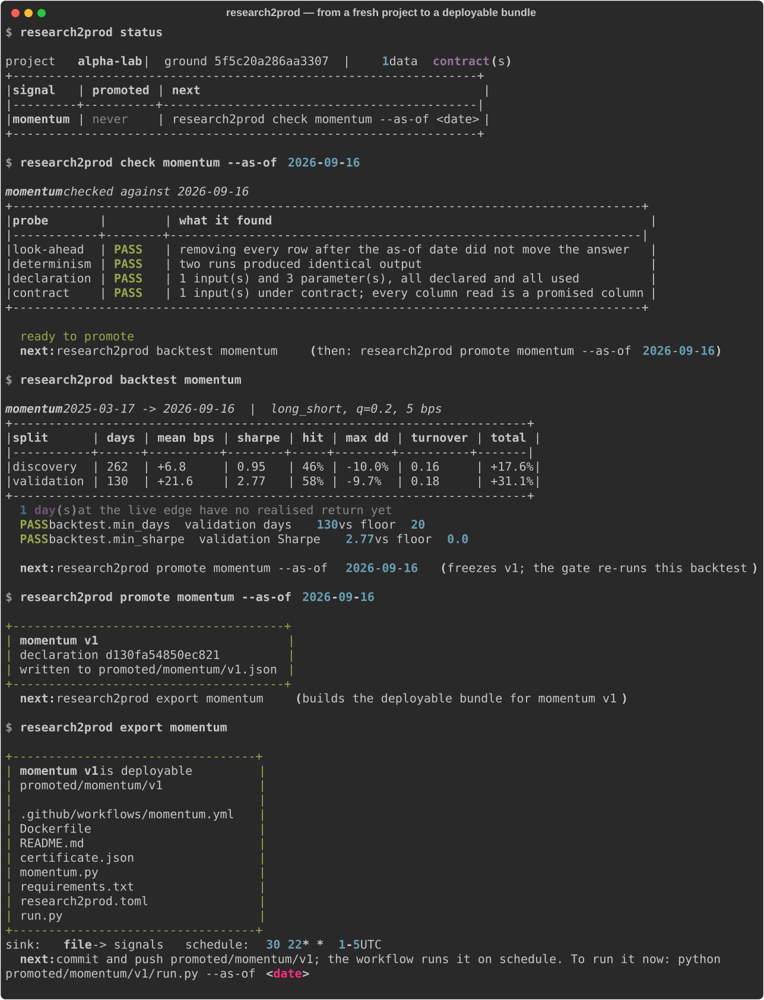

# research2prod

**Guided self-service from quant research to production.**
Write the signal once; it is already production code.

`research2prod` is the bridge from quant research to production trading, built
to be walked without a guide — for quant researchers and PMs who can write working Python but have
no idea what happens after "the backtest looks good." There is no handover.
There is no quant developer rebuilding the signal from a notebook, and no
weeks of back-and-forth verifying that the rebuild still agrees with the
research. The research code runs in production unchanged, because the
project makes it impossible to write it any other way.

```
research2prod new alpha-lab                       # a project with ground, contracts, sample data, one signal, tests
research2prod check momentum --as-of 2026-09-15   # would promotion accept it? look-ahead · determinism · declaration · contract
research2prod backtest momentum                   # discovery / validation splits, same code path as production
research2prod promote momentum --as-of 2026-09-15 # freeze: certificate with golden output, source hash, environment, backtest
research2prod export momentum                     # the deployable unit: runner, Dockerfile, schedule, operator README
```

`git push`, and the job runs on schedule, publishing
`(as_of, key, score, model, version, fingerprint, published_at)` rows to the
sink your trading system already reads. Every command ends by naming the next
one; `research2prod status` answers "where am I?" at any moment.

<p align="center"></p>

<sub>Recorded from the real CLI against a fresh <code>research2prod new</code> project (<code>docs/record_session.py</code>). The sample panel is synthetic; the gate, the freeze and the bundle are not.</sub>

---

## The problem it removes

At an asset manager the loop looks like this: a researcher proves a signal in
a notebook; a quant developer rewrites it for production; the two versions
disagree; weeks go into finding out why; the signal ships late or not at all.
The cost is not just the developer's salary — it is the iteration, and the
research that did not happen while the researcher was explaining their own
work back to someone.

Every fix I have seen for this was a **conversion**: a translator, a code
generator, a "productionisation" checklist. Conversions drift, because the
research version keeps moving and the production version is a copy. `research2prod`
has no conversion step. Instead the template enforces, from the first line
of research, the properties production would otherwise have to add:

| Property | How the template enforces it |
|---|---|
| **No look-ahead** | A signal receives an `AsOfView` bounded at one date. It has no way to reach past it. Not a convention — there is nothing there to read. |
| **Declared inputs and parameters** | `@model(inputs=…, params=…)`. Undeclared inputs raise; unused declarations fail the gate. |
| **Data the platform actually promises** | Each input has a **data contract** in `research2prod.toml`: columns, types, knowledge-time column, owner, freshness. A signal that reads an unpromised column is refused before promotion, not discovered on the first production morning. |
| **One execution path** | Research runs, backtests, probes and production runs all call the same `run()`. The backtest *is* the integration test. |
| **Determinism** | Two runs must produce identical bytes; unseeded randomness and clock reads fail the gate. |
| **Frozen ground** | Universe, calendar, costs and splits live in `research2prod.toml`, never in the signal, and are fingerprinted into every certificate. |
| **Immutable promotion** | `promote` appends a version; it never edits one. There is no `--force`. A gate with an override is a suggestion. |

So `promote` is not a translation. It is a **freeze**: the probes pass, the
certificate records the golden output, the source hash, the interpreter and
library versions, the project ground, the contracts and the backtest — and
`export` lays out a directory that runs the same function through the same
view, plus a Dockerfile, a schedule, and a README written for the operator.
Instant, because nothing was converted.

---

## What a signal looks like

```python
from research2prod import Input, Param, model

@model(
    name="momentum",
    inputs=[Input(name="prices", description="Daily closes, one row per symbol per day.")],
    params=[Param(name="lookback_days", default=60, kind="int")],
    output="score",
)
def momentum(ctx):
    prices = ctx.frame("prices")           # already bounded at ctx.as_of
    lookback = ctx.param("lookback_days")
    scores = {}
    for symbol, rows in prices.group_by("symbol").items():
        closes = [row["close"] for row in rows][-lookback:]
        if len(closes) >= 40 and closes[0] > 0:
            scores[symbol] = closes[-1] / closes[0] - 1.0
    return scores                           # {key: score}
```

That is the entire interface a researcher learns: one decorator, one
function, `ctx.frame`, `ctx.param`, return `{key: score}`. Nothing in the body
filters on the date, and nothing knows whether it is being backtested.

---

## The gate

Promotion asks five questions mechanically, and each fails closed:

1. **Look-ahead** — physically remove every row after the as-of date and run again. If the answer moved, the signal read what it was not entitled to.
2. **Determinism** — run twice; compare bytes.
3. **Declaration** — did the body use exactly what it declared?
4. **Contract** — is every input under a contract, does the data honour it today, and did the signal read only promised columns?
5. **Backtest gates** — optional floors on the validation split (`min_days`, `min_sharpe`, `min_hit_rate`, `max_drawdown`) declared in `research2prod.toml` by whoever owns the project's standards.

`research2prod replay` re-runs a promoted version on its checked date later and says
one of three things: still reproduces; the **data was restated** (same source
hash, different answer — tell the contract owner); or the **code changed** (a
new version, never an edit).

---

## Where the signal goes

The far end of the bridge is a trading system, and it integrates once,
against one row shape:

```
as_of, key, score, model, version, fingerprint, published_at
```

`research2prod.toml` declares the sink: `file` (JSON-lines, what most intakes already
read), `http` (POST the batch to a registry; token from `RESEARCH2PROD_SINK_TOKEN`), or
`custom` (`package.module:function` — route into your own book without forking
this library).

---

## Project layout

```
alpha-lab/
├── research2prod.toml              the ground: calendar, universe, costs, splits, sink, schedule, data contracts
├── signals/               researcher writes here; one file per signal
├── data/                  one CSV per declared input, named for it
├── tests/                 CI runs the promotion gate over every signal
└── promoted/
    ├── momentum/v1.json   the certificate (append-only)
    └── momentum/v1/       the deployable bundle: run.py · momentum.py · research2prod.toml · certificate.json
                           requirements.txt · Dockerfile · README.md · .github/workflows/
```

Bundles and certificates are committed. The data they run on and the rows
they publish are not.

---

## Install

```bash
pip install git+https://github.com/henryzhangpku/research2prod
research2prod new alpha-lab && cd alpha-lab && research2prod status
```

Python ≥ 3.11. Dependencies: `pydantic`, `typer`, `rich`. No dataframe
library — rows are dictionaries, and a real deployment hands the researcher
whatever their shop already uses. What must not change is that the as-of
truncation happens *below* the signal, whatever the frame is made of.

---

## Relationship to Autonomous Quant Researcher

[autonomous-quant-researcher](https://github.com/henryzhangpku/autonomous-quant-researcher)
is an agent that discovers and refutes hypotheses on its own. `research2prod` is how
*any* research — a machine's or a human's — becomes a production signal.
Both share one idea: **declaration → trusted evaluation → gate → immutable
record**. Machine discovers, human codifies, template ships.

## Not in this version

- A drag-and-drop signal composer for researchers who would rather wire
  blocks than write Python. The declaration-first design exists so that a
  composer can emit the same `@model` contract later without a rewrite.
- Adapters for specific brokers or OMSs. The sink contract is the seam;
  `custom` sinks are where those live.

---

Research tooling. Nothing here is investment advice.

**Henry Zhang** — fifteen years building research and production platforms
for systematic investing. [LinkedIn](https://www.linkedin.com/in/henryzhang99/) ·
[GitHub](https://github.com/henryzhangpku)
